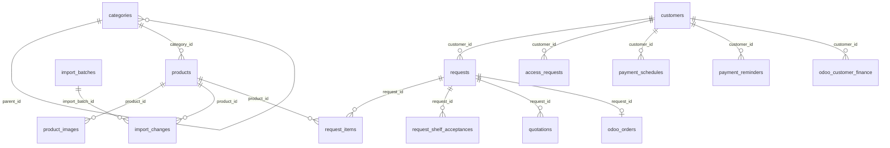
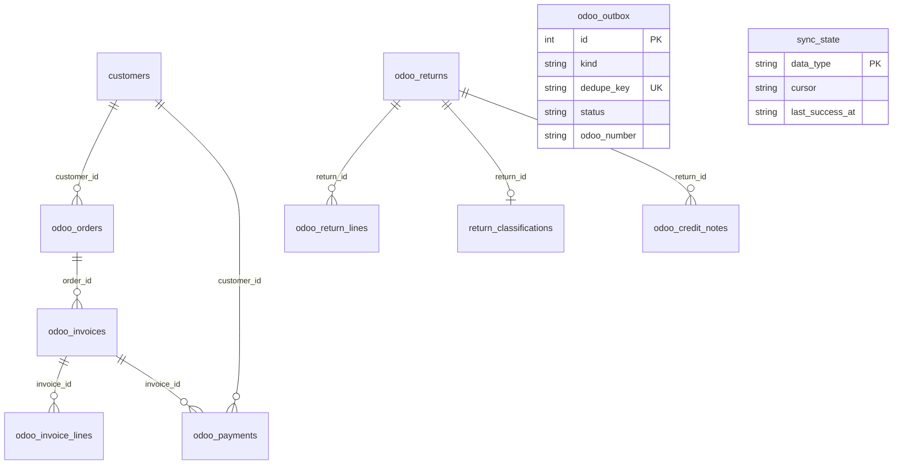
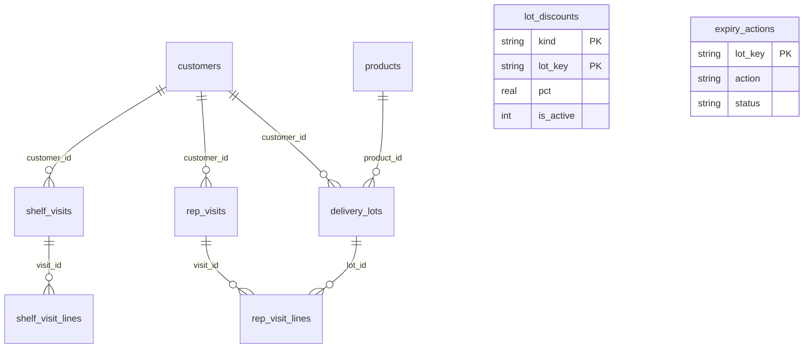

# Box for Less — Database Schema & Data Model (v0.4.2)

Engine: **SQLite** via Node.js built-in `node:sqlite` (`DatabaseSync`).  
All timestamps are **ISO-8601 UTC** formatted strings (`YYYY-MM-DDTHH:mm:ss.sssZ`).  
Foreign key enforcement: `PRAGMA foreign_keys = ON;`  
Journal mode: `PRAGMA journal_mode = WAL;`  
Migration engine: `src/db/connection.js` (`applySchema` + `applyMigrations`). Total: **44 tables**.

---

## 1. Entity Relationship (ER) Diagrams

### Core Catalog, Customers & Order Flow

### Odoo Integration, Invoicing, Returns & Outbox

### Warehouse Expiry, Lots & Sales Rep Visits

---

## 2. Table Specifications by Domain

### Domain 1: Product Master & Catalog Taxonomy
1. **`categories`**
   - Derived index of Odoo product categories.
   - `id` (INTEGER PK), `name` (TEXT), `path` (TEXT UNIQUE), `level` (INTEGER), `parent_id` (INTEGER FK → `categories.id`), `is_active` (INTEGER), `created_at` (TEXT), `updated_at` (TEXT).
2. **`products`**
   - The master record for all products.
   - `id` (INTEGER PK AUTOINCREMENT — internal immutable identity).
   - `source_odoo_id` (TEXT UNIQUE — external Odoo id).
   - `barcode` (TEXT NOT NULL, indexed — mutable business identifier).
   - `name` (TEXT NOT NULL), `box_uom` (TEXT).
   - Stock fields (Odoo controlled): `on_hand`, `free_to_use`, `incoming`, `outgoing`, `forecasted` (REAL).
   - Status & Images: `is_active` (INTEGER), `odoo_category_path` (TEXT), `primary_image_id` (INTEGER FK → `product_images.id`), `category_id` (INTEGER FK → `categories.id`).
   - Audit / Quality: `barcode_change_pending`, `uom_change_pending`, `pending_barcode`, `pending_uom`, `data_quality_status`, `data_quality_notes`, `created_at`, `updated_at`, `last_import_id`, `last_seen_import_id`.
3. **`product_images`**
   - Photos captured and managed inside BFL.
   - `id` (INTEGER PK), `product_id` (INTEGER FK → `products.id`), `is_primary` (INTEGER), `filename` (TEXT), `url_reference` (TEXT), `uploaded_at` (TEXT), `is_active` (INTEGER), `sort_order` (INTEGER).
4. **`import_batches`**
   - Product Excel import audit batch records.
   - `id` (INTEGER PK), `filename`, `file_hash`, `stored_path`, `imported_at`, `confirmed_at`, `completed_at`, row counts (`total_rows`, `valid_rows`, `invalid_rows`, `created_count`, `updated_count`, `unchanged_count`, etc.), `status` (PREVIEW | CONFIRMED | COMPLETED | FAILED), `preview_json`, `notes`.
5. **`import_changes`**
   - Change log for each product attribute modified during imports.
   - `id` (INTEGER PK), `import_batch_id` (INTEGER FK → `import_batches.id`), `product_id` (INTEGER FK → `products.id`), `change_type`, `field`, `old_value`, `new_value`, `row_number`, `barcode`, `review_status`, `message`, `created_at`.

---

### Domain 2: Customers, Access & Authentication
6. **`customers`**
   - Master customer record (mirror of Odoo `res.partner`).
   - `id` (INTEGER PK), `odoo_customer_ref` (TEXT UNIQUE — Odoo ID), `name` (TEXT NOT NULL), `phone` (TEXT), `email` (TEXT), `country` (TEXT), `pricelist` (TEXT — price class tier name), `access_code` (TEXT UNIQUE — 8-char code), `access_code_issued_at` (TEXT), `delivery_address` (TEXT), `session_epoch` (INTEGER), `min_shelf_life_days` (INTEGER), `customer_type` (TEXT: CREDIT | CASH), `salesperson` (TEXT), `registration_ref` (TEXT), `password_hash` (TEXT), `password_set_at` (TEXT), `is_active` (INTEGER), `created_at`, `updated_at`.
7. **`customer_imports`**
   - Independent audit log for customer Excel imports.
   - `id` (INTEGER PK), `filename`, `file_hash`, `status`, row statistics, `preview_json`, `created_at`, `confirmed_at`, `notes`.
8. **`access_requests`**
   - Self-service "I don't have a code" customer registration requests.
   - `id` (INTEGER PK), `reference` (TEXT UNIQUE), `company`, `contact`, `phone`, `email`, `delivery_address`, `note`, `status` (PENDING | APPROVED | REJECTED), `customer_type` (CREDIT | CASH), `customer_id` (FK → `customers.id`), `created_at`, `reviewed_at`, `updated_at`.
9. **`staff_users`**
   - Internal staff accounts for backoffice administration.
   - `id` (INTEGER PK), `name`, `email` (TEXT UNIQUE), `phone`, `phone_key` (TEXT UNIQUE), `role` (SALES_MANAGER | SALES_REP | WAREHOUSE), `rep_id` (TEXT), `password_hash`, `must_change_password`, `is_active`, `created_by`, `created_at`, `updated_at`, `last_login_at`.
10. **`sales_users`**
    - Legacy skeleton for salesperson mappings.

---

### Domain 3: Customer Requests & Quotation Tracking
11. **`requests`**
    - Order requests placed by customers or sales reps (CTN quantities only).
    - `id` (INTEGER PK), `reference` (TEXT UNIQUE, e.g. `REQ-2026-0001`), `customer_id` (FK → `customers.id`), `sales_user_id`, `unlisted_company`, `unlisted_contact`, `unlisted_phone`, `delivery_address`, `needs_customer_match`, `notes`, `status`, `submitted_at`, `stock_as_of`, `deleted_at` (soft delete), `placed_by_rep`, `placed_by_staff_id`, `created_at`, `updated_at`.
12. **`request_items`**
    - Snapshot line items for each requested product.
    - `id` (INTEGER PK), `request_id` (FK → `requests.id`), `product_id` (FK → `products.id` ON DELETE RESTRICT), `quantity_ctn` (INTEGER >= 1), snapshot fields (`product_name_at_request`, `barcode_at_request`, `box_uom_at_request`, `available_ctn_at_request`), clearance fields (`clearance_lot_key`, `clearance_lot_name`, `clearance_expiry`, `clearance_cartons`, `clearance_pct`), `created_at`.
13. **`request_shelf_acceptances`**
    - Short shelf-life acceptance log (evidence for no-return guarantee).
    - `id` (INTEGER PK), `request_id` (FK → `requests.id`), `customer_id`, `barcode`, `min_days`, `expiry_date`, `short_cartons`, `accepted_at`.
14. **`quotations`**
    - Link to Odoo draft quotation references.
    - `id` (INTEGER PK), `request_id` (FK → `requests.id`), `odoo_reference`, `status`, `created_at`, `updated_at`.

---

### Domain 4: Odoo Outbox & Sync Framework
15. **`odoo_outbox`**
    - Idempotent write queue to Odoo (Draft Quotations & Approved Partners).
    - `id` (INTEGER PK), `kind` (CREATE_PARTNER | DRAFT_QUOTATION), `dedupe_key` (TEXT UNIQUE), `payload` (JSON TEXT), `status` (PENDING | SENT | FAILED), `attempts`, `next_attempt_at`, `first_attempt_at`, `odoo_id`, `odoo_number`, `last_error`, `created_at`, `sent_at`.
16. **`sync_state`**
    - High-water mark cursor and health status per Odoo data entity.
    - `data_type` (TEXT PK: `products`, `stock`, `customers`, `invoices`, `orders`, etc.), `cursor` (Odoo `write_date`), `last_success_at`, `last_attempt_at`, `last_error`, `records_last`, `runs_ok`, `runs_failed`.
17. **`sync_changes`**
    - Audit log for changes detected during Odoo sync cycles.
    - `id` (INTEGER PK), `run_at`, `data_type`, `odoo_id`, `change`, `detail`.
18. **`odoo_call_log`**
    - Telemetry log of external Odoo API calls (API key never recorded).
    - `id` (INTEGER PK), `at`, `model`, `method`, `count`, `ms`, `ok`, `error`.

---

### Domain 5: Odoo Financial & Sales Read-Copy
19. **`odoo_orders`**
    - Local cache of Odoo `sale.order` status.
    - `id` (INTEGER PK), `request_id` (FK → `requests.id`), `customer_id` (FK → `customers.id`), `odoo_number` (e.g. `S00012`), `state` (RECEIVED | DRAFT | APPROVED | DISPATCHED | INVOICED | PAID | CANCELLED), `amount_total`, `amount_open`, `cartons_ordered`, `cartons_delivered`, timestamp milestones (`received_at`, `sent_at`, `approved_at`, `dispatched_at`, `invoiced_at`, `paid_at`, `cancelled_at`), `updated_at`.
20. **`odoo_invoices`**
    - Local cache of Odoo customer invoices (`account.move` with `out_invoice`).
    - `id` (INTEGER PK), `number` (TEXT UNIQUE), `customer_id` (FK → `customers.id`), `order_id` (FK → `odoo_orders.id`), `amount`, `amount_due`, `invoice_date`, `due_date`, `state` (OPEN | PAID).
21. **`odoo_invoice_lines`**
    - Line-level detail for invoices.
    - `id` (INTEGER PK), `invoice_id` (FK → `odoo_invoices.id`), `barcode`, `product_name`, `category`, `cartons`, `amount`, `discount`, `lot_name`.
22. **`odoo_payments`**
    - Cash and bank payments recorded in Odoo (`account.payment`).
    - `id` (INTEGER PK), `customer_id` (FK → `customers.id`), `invoice_id` (FK → `odoo_invoices.id`), `amount`, `paid_on`.
23. **`odoo_customer_finance`**
    - Live credit limit and balance summary.
    - `customer_id` (INTEGER PK FK → `customers.id`), `credit_limit`, `amount_owed`, `overdue`, `updated_at`.
24. **`odoo_returns`**
    - Delivery return receipts (`stock.picking` incoming return).
    - `id` (INTEGER PK), `number` (TEXT UNIQUE), `customer_kind`, `customer_ref`, `customer_name`, `rep_name`, `sales_order`, `received_on`, `created_at`.
25. **`odoo_return_lines`**
    - Returned lots and carton quantities.
    - `id` (INTEGER PK), `return_id` (FK → `odoo_returns.id`), `barcode`, `product_name`, `lot_name`, `category`, `cartons`.
26. **`return_classifications`**
    - Warehouse inspection classification of returned stock.
    - `return_id` (INTEGER PK FK → `odoo_returns.id`), `reason` (DAMAGED | EXPIRED | OTHER), `note`, `classified_by`, `classified_at`.
27. **`odoo_credit_notes`**
    - Credit notes issued in Odoo (`out_refund`).
    - `id` (INTEGER PK), `number` (TEXT UNIQUE), `customer_kind`, `customer_ref`, `customer_name`, `rep_name`, `invoice_number`, `return_id` (FK → `odoo_returns.id`), `kind` (RETURN | DISCOUNT | OTHER), `amount`, `issued_on`.
28. **`order_check_log`**
    - Audit log for blocked checkout attempts (Low Stock or Over-Credit).
    - `id` (INTEGER PK), `customer_id`, `kind` (LOW_STOCK | CREDIT), `barcode`, `product_name`, `cartons_wanted`, `cartons_short`, `order_value`, `available_credit`, `at`.

---

### Domain 6: Warehouse Expiry, Lots & Field Rep Audits
29. **`expiry_actions`**
    - Warehouse decisions for perishable lots nearing expiry.
    - `lot_key` (TEXT PK: `<barcode>|<lot name>`), `action`, `owner`, `decide_by`, `status` (OPEN | CLOSED), `updated_at`.
30. **`lot_discounts`**
    - Clearance discounts applied to short-dated lots.
    - `kind` (TEXT PK: CLEARANCE | SHELF), `lot_key` (TEXT PK), `pct` (REAL), `is_active` (INTEGER), `set_by`, `set_at`, `ended_by`, `ended_at`.
31. **`lot_discount_log`**
    - History of discount changes on lots.
    - `id` (INTEGER PK), `kind`, `lot_key`, `action` (SET | CHANGE | REMOVE), `pct`, `by_name`, `at`.
32. **`shelf_visits`**
    - Sales rep shop visits auditing customer shelf inventory.
    - `id` (INTEGER PK), `rep_id`, `customer_id`, `visited_on`, `created_at`.
33. **`shelf_visit_lines`**
    - Line-level lot check and proposed shelf expiry discounts.
    - `id` (INTEGER PK), `visit_id` (FK → `shelf_visits.id`), `record_key`, `cartons_on_shelf`, `outcome`, `discount_pct`, `contact_name`, `agreement`, `approval_status`, `approval_reason`, `approved_at`, `credit_note_ref`, `offered_pct`, `created_at`.
34. **`delivery_lots`**
    - Log of lots delivered to customer locations with expiry dates.
    - `id` (INTEGER PK), `customer_id` (FK → `customers.id`), `product_id` (FK → `products.id`), `lot_code`, `delivered_ctn`, `expiry_date`, `delivered_at`, `created_at`.
35. **`rep_visits`**
    - Rep visit log for customer shelf lot audits.
    - `id` (INTEGER PK), `customer_id` (FK → `customers.id`), `rep_name`, `contact_name`, `no_return_agreed`, `visited_at`.
36. **`rep_visit_lines`**
    - Itemized shelf check per lot during a rep visit.
    - `id` (INTEGER PK), `visit_id` (FK → `rep_visits.id`), `lot_id` (FK → `delivery_lots.id`), `shelf_ctn`, `outcome` (OK | SOLD_OUT | RETURN | NOT_CHECKED), `photo_file`.
37. **`shop_reps`**
    - Assignment of customer shops to sales reps.
    - `customer_id` (INTEGER PK), `rep_id` (TEXT), `set_by`, `set_at`.

---

### Domain 7: Governance, Visibility & Reminders
38. **`visibility_rules`**
    - Selective hiding of products/categories/brands from customer groups.
    - `id` (INTEGER PK), `scope_type` (ALL | PRICE_CLASS | CUSTOMER), `scope_value`, `target_type` (CATEGORY | PRODUCT | BRAND), `target_value`, `is_active`, `created_by`, `created_at`, `removed_by`, `removed_at`.
39. **`visibility_log`**
    - Audit log of additions and revocations of visibility rules.
    - `id` (INTEGER PK), `rule_id`, `action` (ADDED | REMOVED), `by`, `at`, `detail`.
40. **`payment_schedules`**
    - Reminder schedule configuration per customer.
    - `customer_id` (INTEGER PK FK → `customers.id`), `kind` (DUE_DATE | WEEKLY | MONTHLY), `weekday`, `day_of_month`, `updated_by`, `updated_at`.
41. **`payment_reminders`**
    - Dispatch records of payment reminder notifications.
    - `id` (INTEGER PK), `customer_id` (FK → `customers.id`), `remind_on`, `kind` (BEFORE | DUE | OVERDUE), `to_address`, `subject`, `body`, `invoice_count`, `total_due`, `status` (PENDING | SENT | NO_CONTACT), `created_at`, `sent_at`, `sent_by`.

---

### Domain 8: Monthly Snapshots & Executive Reporting
42. **`stock_snapshots`**
    - Month-end inventory snapshot by category for valuation and trend reports.
    - `snap_on` (TEXT), `category` (TEXT), `on_hand` (REAL), `free` (REAL). Composite PK (`snap_on`, `category`).
43. **`report_targets`**
    - Monthly sales and collection targets set by executive management.
    - `scope` (COMPANY | REP), `scope_value`, `measure`, `month` (YYYY-MM | DEFAULT), `value` (REAL), `set_by`, `set_at`. Composite PK (`scope`, `scope_value`, `measure`, `month`).
44. **`report_notes`**
    - Executive monthly narrative notes (What happened, Why, Action items).
    - `report` (CEO | SALES | WAREHOUSE), `month` (YYYY-MM), `what`, `why`, `action`, `written_by`, `written_at`. Composite PK (`report`, `month`).
